

MGIMO×AI CHALLENGE · кейс «Цифровой деканат будущего»

<h1 class="title">«Ориентир» — цифровой деканат</h1>

Описание процесса создания

Версия от 21.11.2026, состояние репозитория на коммите 158977f. Концепт для конкурса, не официальный сервис МГИМО. Все люди, оценки и заявки в прототипе вымышлены.

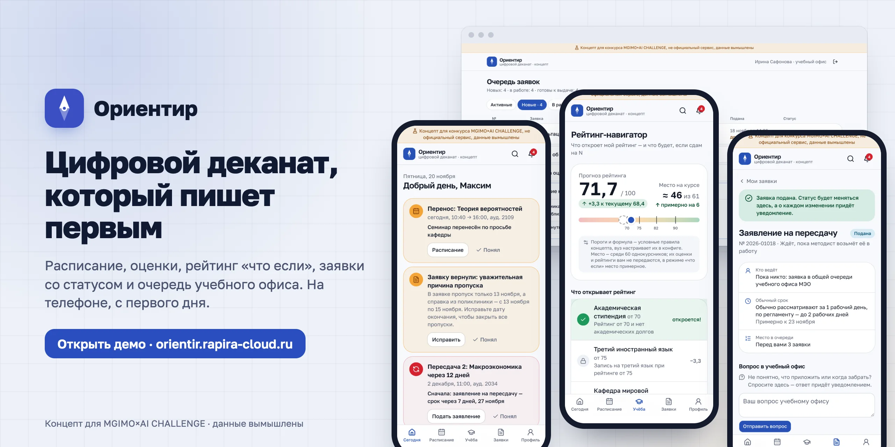

## Ссылки и тестовые аккаунты

| Что | Ссылка | Примечание |
| --- | --- | --- |
| Живое демо | [orientir.rapira-cloud.ru](https://orientir.rapira-cloud.ru) | Работает до 28.11.2026. Вход одной кнопкой «Войти» или по логину и паролю |
| Демо-видео | [orientir.rapira-cloud.ru/video/demo.mp4](https://orientir.rapira-cloud.ru/video/demo.mp4) | 2:32, без звука, с титрами |
| Исходный код | [github.com/DverkuOff/digital-dean-concept](https://github.com/DverkuOff/digital-dean-concept) | README, документы процесса, файлы для ИИ-агентов |
| Сценарий показа | `pitch/demo-script.md` в репозитории | Что смотреть и в каком порядке, проверка безопасности |

Пароль у всех аккаунтов: `demo2026`. На странице входа у каждого персонажа есть кнопки «Войти», «копия 2» и «копия 3».

| Персонаж | Логины | Что посмотреть |
| --- | --- | --- |
| Максим Орлов, 2 курс | `orlov`, `orlov2`, `orlov3` | Долг по макроэкономике и режим пересдачи, перенос пары, заявку вернули с причиной |
| Анна Соколова, 2 курс | `sokolova`, `sokolova2`, `sokolova3` | Отличница без долгов: рейтинг 87,5 и пороги, готовая справка |
| Методист учебного офиса | `metodist`, `metodist2`, `metodist3` | Очередь заявок: взять в работу, вернуть с причиной, готово |

Копии нужны, чтобы эксперты не мешали друг другу. Действия под `orlov2` не меняют данные `orlov` и `orlov3`. Очередь методиста общая: это одна служба.

<figure class="wide small">
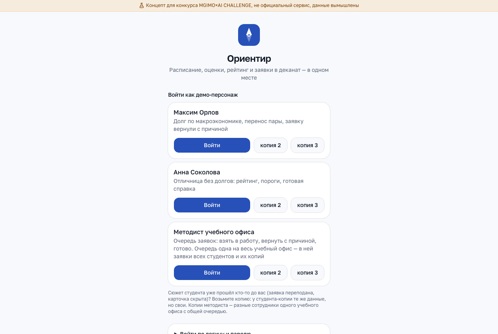
<figcaption>Рис. 1. Страница входа живого демо, снимок 21.11.2026. Плашка «Концепт для конкурса…» есть на каждой странице.</figcaption>
</figure>

## Содержание

1. Проблема студентов и выбор разделов
2. ИИ-инструменты, IDE и сервисы
3. Этапы работы
4. Файлы для ИИ-агентов
5. Ключевые постановки задач ИИ
6. Ошибки ИИ и как их поймали
7. Скриншоты: от первой версии до готового кабинета
8. Вход, хранение данных и защита
9. Что сделано вручную
10. Границы прототипа

## 1. Проблема студентов и выбор разделов

### 1.1. Проблема

Кейс описывает раздробленность учебной жизни: расписание на сайте, оценки в отдельной системе, справки через очередь, объявления в чатах и на почте (бриф, §2).

Чтобы понять, какие задачи студента за этим стоят, до разработки провели исследование открытых источников по четырём направлениям: прошлые победители похожих конкурсов, конкуренты (14 личных кабинетов и студенческих приложений), предметная область и технологии. Результаты лежат в `docs/research/01–04`.

Открытых российских данных о недовольстве учебными офисами исследование не нашло. Зарубежные опросы дают ориентир: по Unit4 (2016, 2000 студентов) треть студентов разочарованы системами администрирования, по Gravyty (2026, США) 76% хотят решать административные вопросы без звонков и визитов к сотрудникам.

### 1.2. Опрос однокурсников

Опрос однокурсников не проводился. В плане (`docs/plan.md`) на 20.11 стоял короткий опрос 2–3 студентов о правилах рейтинга, и он остался невыполненным.

Поэтому выбор разделов опирается на исследование открытых источников, перечисленное ниже. Правила рейтинга (формула, пороги, число попыток) вынесены в конфиг и на экране помечены как условные: официальное положение о балльно-рейтинговой системе МГИМО прочитать не удалось, сайт вуза закрыт проверкой от ботов.

### 1.3. Что показало исследование и как это отразилось в кабинете

| Находка исследования | Источник в репозитории | Что сделали в кабинете |
| --- | --- | --- |
| Главная боль не в нехватке функций, а в раздробленности и плохой находимости. Айтрекинг ЛК РАНХиГС (2026): повторный вход в разные системы, раздел «Заказ справки» новички ищут почти вдвое дольше старожилов, главную страницу игнорируют | `02-competitors.md` | Один кабинет с нижним таббаром; поиск по своим данным (Ctrl+K); главный экран «Сегодня» собирает важное за день |
| Уведомления — самая частая жалоба: у Canvas Student 54% отзывов об уведомлениях негативные | `02-competitors.md` | «Сегодня»: 3–5 карточек по правилам, дубли схлопываются, кнопка «Понял» убирает карточку |
| У найденных ЛК (РУДН, РАНХиГС) у заявки виден только статус. Ответственного и срок не показывает никто | `02-competitors.md`, «Пробелы» | Прозрачность заявки: кто ведёт, обычный срок, место в очереди, вопрос в учебный офис внутри заявки |
| По отзывам студентов МГИМО, учёба строится вокруг 100-балльного рейтинга: по нему распределяют кафедры и третий язык. Во всех найденных ЛК рейтинг виден только постфактум | `03-domain.md`, `02-competitors.md` | Рейтинг-навигатор «что если» и режим пересдачи, замкнутый на заявление в учебный офис |
| Самая массовая операция деканата — не справка об обучении, а подтверждение пропуска по уважительной причине (Центр «Студент» ВШЭ: 81 000+ заявок за два года) | `03-domain.md` | Шесть типов заявок: справка об обучении, справка для военкомата, уважительная причина пропуска, выписка оценок, заявление на пересдачу, консультация перед пересдачей |
| Официальное «МГИМО.Расписание» критикуют за «бесконечную загрузку» | `02-competitors.md` | Скелетоны загрузки; «Сегодня», «Расписание» и «Учёба» открываются без сети |

### 1.4. Как выбирали состав

Обязательное ядро брифа (вход и профиль, расписание, успеваемость, заявки, уведомления) взяли целиком: без него работа считается неполной.

Идеи поверх ядра генерировали три независимых ИИ-агента с разных углов: «боль и данные», «ниша», «вау-демо». Получилось 15 идей (`docs/ideas/ideas-*.md`). Отдельный агент в роли жюри сгруппировал дубли, оценил кластеры по четырём критериям брифа и двум барьерам (выполнимость за оставшиеся дни, сила демо) и дал рекомендацию (`docs/ideas/critique.md`).

| Решение | Что именно | Почему |
| --- | --- | --- |
| Взяли в центр | Рейтинг-навигатор «что если» с режимом пересдачи | Отвечает на вопрос «как у меня дела» для студента МГИМО; работает без внешних сервисов; кнопка «Подать заявление» связывает успеваемость с деканатом |
| Взяли | Главный экран «Сегодня» на правилах | Превращает обязательные уведомления в «деканат пишет первым» почти без затрат |
| Взяли урезанно | Очередь методиста одной страницей, без канбана | Делает сценарий брифа «подать заявку → увидеть статус» настоящим: статус меняет человек в соседнем окне |
| Отказались | «Скажи, что случилось» на GigaChat | Внешняя точка отказа на пути демо, не было времени замерить точность |
| Отказались | Справка с QR-кодом | Риск выдать документ за официальный |
| Отказались | Чат-бот, сторис, i18n, push-уведомления | Чат-бот поверх ЛК — самая частая идея в теме; остальное дорого и не нужно для сценария |

Во втором и третьем заходах добавили приёмы, найденные у аналогов: офлайн-режим (жалобы на «МГИМО.Расписание»), подписку на расписание в календарь (HSE App X, Modeus), глобальный поиск (Utah 360, исследование РАНХиГС), заметку к паре («Кампус»), тёмную тему. «Вопрос в учебный офис» появился после замечания независимой проверки: как студенту связаться с деканатом, если вопрос не укладывается в шесть типов заявок.

## 2. ИИ-инструменты, IDE и сервисы

В таблице только то, что подтверждается файлами репозитория.

| Инструмент | Для чего использован | Где это видно |
| --- | --- | --- |
| **Claude Code (CLI)**, модель Claude Opus 5.5 с контекстом 1M токенов | Основной ИИ-ассистент и среда разработки: отдельной IDE не было, вся работа шла в Claude Code в терминале. Исследование, генерация и отбор идей, план, весь код приложения, спецификации, тесты, README, сборка демо-видео и картинок для README | `docs/process/prompts.md`, `CLAUDE.md`, README «Как работали с ИИ» |
| Подагенты Claude Code | 4 агента исследования, 3 генератора идей, агент-жюри для отбора; независимая проверка (жюри и технический аудит); тестировщик ПМИ на проде; ревьюер доступа `access-reviewer` | `docs/process/prompts.md`, `docs/decisions.md`, `.claude/agents/` |
| Веб-поиск и чтение страниц в ассистенте (WebSearch, WebFetch) | Источники для исследования, проверка, не занята ли идея | `docs/research/*`, `docs/ideas/critique.md`, `.claude/settings.json` |
| context7 (MCP-сервер) | Актуальная документация библиотек, в том числе Better Auth 1.7 | `docs/process/prompts.md` |
| Документация Next.js из `node_modules/next/dist/docs` | Сверка с API Next.js 16 перед кодом: в нём middleware называется `proxy.ts`, в новом шаблоне включён `cacheComponents` | `AGENTS.md`, `docs/process/prompts.md` |
| ESLint, TypeScript | Проверка каждой правки ассистента: хук запускает ESLint после каждого изменения файла | `.claude/hooks/lint-edited.sh` |
| Playwright | 83 сценария в браузере на ширине 360 px, съёмка скриншотов, запись экрана для демо-видео | `e2e/`, `playwright.screens.config.ts`, `pitch/demo/scripts/record.mjs` |
| Vitest | 69 юнит-тестов: формула рейтинга, правила «Сегодня», валидация, даты, сид | `src/lib/**/*.test.ts` |
| HyperFrames 0.9.72 (анимация на GSAP) | Монтаж демо-видео с титрами из записей Playwright | `pitch/demo/` |
| ffmpeg | Сборка кадров записи в клипы, обложка видео | `pitch/demo/scripts/*.mjs` |
| shadcn/ui (Radix), Tailwind CSS 4, иконки lucide-react, шрифт Golos Text | Дизайн интерфейса: единый стиль на токенах темы, тёмная тема без переделки экранов | `src/components/ui`, `.claude/rules/ui.md` |
| Next.js 16, React 19, TypeScript, Drizzle ORM, PostgreSQL 17, Better Auth, argon2id, zod | Стек приложения | `package.json`, `AGENTS.md` |
| Docker, Caddy, собственный сервер | Хостинг живого демо с HTTPS | `deploy/`, `Dockerfile`, README |
| Amvera | Подготовлен альтернативный конфиг деплоя (`amvera.yml`), для демо не использовался | `docs/decisions.md` |
| GitHub, Dependabot | Репозиторий; два алерта о транзитивных зависимостях закрыты | `docs/decisions.md` |

Дизайн и тексты интерфейса делал тот же ассистент, прямо в коде, по правилам `.claude/rules/ui.md`. Для анимаций и полировки интерфейса ассистент использовал скиллы Claude Code: [emilkowalski/skills](https://github.com/emilkowalski/skills) (анимации) и apple-design.

Логотип «Ориентира» (компас в синем квадрате) нарисовал тот же ассистент кодом, как SVG (`src/app/icon.svg`); PNG-иконки для установки на телефон сделаны из него. Обложка README (`media/hero.webp`) собрана ассистентом из настоящих скриншотов прототипа. Генераторы картинок (Kandinsky, Midjourney и т. п.), v0 и Figma не использовались. Текст брифа перенесён из личного кабинета копированием, без конвертеров. Изображения в README и в этом документе построены на настоящих снимках работающего прототипа. Снимки делает Playwright, рис. 1 снят headless Chrome с живого демо.

Языковая модель внутри самого кабинета не используется, поэтому ключей ИИ в прототипе нет.

## 3. Этапы работы

<b>Постановка</b> что сделать, ссылка на спеку, какой тест должен пройти

→

<b>Код ИИ</b> чистая функция с тестом, затем доступ к данным, затем экран

→

<b>Проверка</b> хук ESLint, юнит-тесты, Playwright на 360 px

→

<b>Независимая проверка</b> агенты, которые не писали код

→

<b>Падающий тест, правка</b> запись в журнал решений

| Этап | Дата | Что делал ИИ | Результат |
| --- | --- | --- | --- |
| Исследование | 11.11 | 4 подагента: прошлые победители, конкуренты, предметная область, технологии | `docs/research/01–04` |
| Идеи | 11.11 | 3 генератора с разных углов, 15 идей | `docs/ideas/ideas-*.md` |
| Отбор | 11.11 | Агент-жюри по критериям брифа | `docs/ideas/critique.md` |
| План | 17.11 | Ведущий агент: Must/Should/Won't, порядок урезания, демо-момент одной фразой | `docs/plan.md`, `pitch/demo-script.md` |
| Первый заход | 17.11 | Каркас, вход, сид, сквозной путь брифа, очередь методиста, тесты на доступ, рейтинг, «Сегодня», спеки, Docker | Ядро и две главные идеи работают, все сценарии закрыты тестами |
| Второй заход | 17.11 | Алерты зависимостей; офлайн, календарь, прозрачность заявки, поиск, заметка к паре, тёмная тема — каждая фича отдельным коммитом | 6 фич с тестами и записями в журнале |
| Независимая проверка и третий заход | 17.11 | Агенты-проверяющие (жюри и аудитор атак); затем 10 пунктов правок; прогон `access-reviewer` | Закрыты критичная и важные находки, раздел в `docs/decisions.md` |
| Деплой и испытания на проде | 20.11 | Деплой на свой сервер; два круга ПМИ субагентом-тестировщиком на живом демо; правки | Живое демо, вид «Месяц», правдоподобный календарь сида |
| Видео и README | 20.11 | Запись сценария в Playwright, монтаж в HyperFrames, README с обложкой и скриншотами | Демо-видео 2:32, README |

Вся история — 54 коммита в репозитории. Каждый коммит — один работающий шаг, после которого сборка и тесты зелёные.

## 4. Файлы для ИИ-агентов

Файлы для ассистента лежат в репозитории и описывают, как работать именно с этим кодом.

| Файл | Назначение |
| --- | --- |
| `CLAUDE.md` | Вход для ассистента: где лежат требования, план, спеки и журнал; какие хуки, агенты и команды есть; правила работы. «Готово» значит, что тест или ручной проход зелёный, а не «код написан» |
| `AGENTS.md` | Правила для любых агентов (Claude Code, Codex, Cursor): карта кода, 12 жёстких правил, проверки перед коммитом, как ставить задачу агенту |
| `.claude/rules/security.md` | Правила для серверного кода. Подгружаются, когда агент трогает `src/server/**` или `src/app/**` |
| `.claude/rules/ui.md` | Правила интерфейса: 360 px, токены цвета, пустые состояния, формы, тексты без канцелярита |
| `.claude/rules/data.md` | Правила сида и миграций: только вымышленные данные, все даты от текущего дня |
| `.claude/agents/access-reviewer.md` | Субагент-ревьюер: проверяет изменения на доступ к чужим данным, ничего не правит сам, возвращает таблицу находок |
| `.claude/hooks/lint-edited.sh` | Хук после каждой правки: ESLint по изменённому файлу, ошибки сразу возвращаются ассистенту |
| `.claude/commands/screens.md`, `demo-check.md` | Команды: переснять скриншоты на свежем демо; полная проверка перед показом |
| `.claude/settings.json` | Разрешения: ассистенту запрещено читать `.env`, править оригинал брифа и делать force push |
| `docs/specs/*.md` | Пять спецификаций: рейтинг, «Сегодня», доступ, модель данных, офлайн. Правило: меняешь поведение — обнови спеку |
| `docs/decisions.md`, `docs/process/prompts.md` | Журнал решений и ошибок ИИ; постановки задач |

Пример правила, которое подгружается при работе с серверным кодом (`.claude/rules/security.md`, дословно):

> Владелец — в условии запроса: `where(and(eq(t.id, id), eq(t.studentId, me.id)))`. Нельзя сначала выбрать по id, а потом сравнить владельца в JS.

Сначала эти файлы декларировали больше, чем работало. Независимая проверка заметила, что `CLAUDE.md` наполовину состоял из шаблона, а обещанного хука в `.claude/` не было. После этого `CLAUDE.md` переписали под репозиторий, а обещания заменили работающими вещами: хук ESLint проверили на чистом файле (0 ошибок) и на файле с `let` вместо `const` (2 ошибки), добавили агента `access-reviewer` и две команды.

## 5. Ключевые постановки задач ИИ

Цитаты взяты из `docs/process/prompts.md`. Постановка 1 там приведена сокращённо, по смыслу; полная версия хранится в истории сессии.

### 5.1. Разработка ядра и главных идей (17.11)

> **Что выбрано (не пересматривай):** ядро полностью; очередь методиста одной страницей без канбана; центральная фича — рейтинг-навигатор «что если» (100-балльная шкала, пороги с пометкой «условные правила концепта», ползунок «если сдам на N», место на курсе только агрегатом)…
>
> **Обязательные требования:** IDOR-защита в слое доступа к данным, Server Actions считаем публичными эндпоинтами, чужая заявка → 404, Playwright-тест на это; argon2id; секреты только в .env; только вымышленные данные; плашка «концепт» на каждой странице; сид относительно now(); 360 px…

Состав решён на этапе отбора, поэтому постановка запрещает его пересматривать. Требования брифа записаны как проверяемые условия («→ 404», «Playwright-тест», «360 px»), а не как пожелания.

Результат: за день сквозной путь брифа, очередь методиста, рейтинг-навигатор и «Сегодня», все сценарии закрыты тестами Playwright; спеки и правила для агентов.

### 5.2. Фичи у аналогов (17.11, второй заход)

> Потом фичи по выгоде, каждая отдельным коммитом, после каждой build + unit + e2e (360 px) зелёные: PWA с офлайном для расписания, оценок и «Сегодня» (кэш только для своего пользователя, при выходе очищается); подписка на расписание в календарь по секретному токену с перевыпуском…

Условие безопасности сформулировано вместе с фичей, поэтому агенту не нужно додумывать, где граница доступа.

### 5.3. Офлайн-режим (подзадача)

> офлайн для трёх страниц, кэш раздельный по пользователю и стирается при выходе; тест должен доказать, что после выхода без сети персональных данных нет

Тест прошёл с первого раза, поэтому агент проверил его «на поломку»: временно отключил очистку кэша при выходе, и тест упал. Значит, тест действительно ловит утечку.

### 5.4. Подписка на расписание (подзадача)

> личная ссылка-подписка, токен случайный, не id; перевыпуск делает старую недействительной; тест: старый или чужой токен → 404

Агент добавил то, чего не было в постановке: в базе хранится только хеш токена, поэтому утечка базы не даёт рабочих ссылок.

### 5.5. Правки по независимой проверке (17.11, третий заход)

> Скрипты атак аудитора перенеси в e2e/юнит-тесты как регрессионные (сначала тест падает, потом чинишь). Порядок: 1) закрыть эндпоинты Better Auth, через которые любой меняет пароль демо-аккаунта; 2) копии персонажей и кнопки «Войти как…»; 3) даты сида доживают до 28.11; 4) рейтинги однокурсников не уходят в браузер…

Проверяли агенты, которые не писали код, поэтому их находки не подтверждали гипотезу автора. Требование «сначала падающий тест» показывает, что тест действительно ловит проблему.

### 5.6. Шаблон постановки в AGENTS.md

> Указать: экран или модуль, ссылку на спеку в docs/specs/, критерий готовности (какой тест должен пройти). Новая бизнес-логика — сначала чистая функция с юнит-тестом в `src/lib`, потом DAL, потом экран.

| Приём | Как сработал |
| --- | --- |
| Чистая функция и тест до экрана | Формула рейтинга проверена контрольным примером из сида: Орлов 68,4 → 71,7 при пересдаче на 70 |
| Сверка с актуальной документацией | Без неё код был бы написан под Next.js 14/15, а не под 16 |
| Тест безопасности с контрольным опытом | Студент отправляет настоящую форму методиста, и статус не меняется; та же отправка от методиста срабатывает. Так видно, что отказ дал сервер, а не сломанный запрос |
| Правила по путям | Правило безопасности подгружается только при работе с серверным кодом |

## 6. Ошибки ИИ и как их поймали

Журнал `docs/decisions.md` фиксирует каждую ошибку: что случилось, чем поймали, что изменили. Ниже пять показательных случаев.

Случай 1. Правила «Сегодня» не учитывали падежи

<b>Что случилось.</b> Код искал название дисциплины в тексте дедлайна как есть. «Макроэкономика» не находилась в «…по макроэкономике», и пересдача появлялась двумя карточками.

<b>Как поймали.</b> Самопроверка сгенерированного кода на реальных строках сида.

<b>Что изменили.</b> Сравнение по основе слова и юнит-тест, чтобы ошибка не вернулась.

Случай 2. Чужая заявка отдала бы статус 200 вместо 404

<b>Что случилось.</b> По плану над страницей заявки лежал скелетон загрузки. При потоковой отрисовке Next.js ответ «не найдено» для чужой заявки уходит со статусом 200. Тест по статусу упал бы, а эксперт с инструментами разработчика увидел бы 200.

<b>Как поймали.</b> Ревью плана тестов по документации Next.js.

<b>Что изменили.</b> Скелетон перенесли на список заявок. Правило «не ставить скелетон над страницей, которая отвечает 404» записали в <code>AGENTS.md</code> и спеку доступа.

Случай 3. Точные рейтинги однокурсников уходили в браузер

<b>Что случилось.</b> Страница рейтинга передавала в браузер массив из 61 точного рейтинга. Имён там не было, но лучшего на курсе все знают, поэтому его рейтинг был раскрыт. ИИ спроектировал «агрегат» и сам же проверил его по слабому признаку: тест искал только фамилии.

<b>Как поймали.</b> Независимая проверка, которая не писала этот код.

<b>Что изменили.</b> Место считается на сервере и уходит одним числом; для «что если» в браузер передаётся только гистограмма по корзинам в 5 баллов; при выборке меньше 10 человек место скрыто. Регрессионный тест считает в SQL пять лучших рейтингов и проверяет, что их нет на странице: до правки упал, после проходит. Позже агент <code>access-reviewer</code> заметил, что крайние корзины с 1–2 людьми всё ещё выдают лидера, и их стали сливать до трёх человек.

Случай 4. Любой посетитель мог сменить пароль демо-аккаунта

<b>Что случилось.</b> Библиотека входа по умолчанию открывает служебные адреса: смену пароля, смену логина, отзыв сессий. Пароль демо-аккаунтов опубликован, поэтому один запрос ломал вход всему жюри. Тесты это не ловили: они проверяли доступ к данным, а не служебные адреса библиотеки.

<b>Как поймали.</b> Технический аудит: аудитор сменил логин <code>orlov</code> одним запросом, после чего вход давал ошибку.

<b>Что изменили.</b> Наружу открыты только вход, выход и проверка сессии, остальное отвечает 404. Тест сначала упал, после правки проходит: 9 атак дают 404, логин и имя не изменились. Вывод для процесса: «безопасность по умолчанию» сторонней библиотеки нужно проверять отдельно, по списку её адресов.

Случай 5. Юнит-тест закреплял ошибку

<b>Что случилось.</b> В файле календаря точка с запятой не экранировалась, а юнит-тест проверял именно такой, неправильный результат. Экранирование «съел» скрипт, которым правили код.

<b>Как поймали.</b> Технический аудит.

<b>Что изменили.</b> Исправили код и тест; новый тест сначала упал на старом коде. Правило: правки с обратными слешами делать точечной заменой, а не через скрипт с интерпретацией строки.

Другие случаи из журнала, коротко:

| Ошибка ИИ | Чем поймали |
| --- | --- |
| Тест гонки кликал двумя браузерами, и второй клик ждал исчезнувшую кнопку: тест проверял таймаут, а не гонку | Проверка теста «на поломку»; тест переписан на две параллельные отправки одной формы |
| Локатор теста совпал со скрытым служебным элементом Next.js с той же ролью | Прогон Playwright |
| Скриншоты снимались после тестов, которые меняют данные, и не показывали главный сюжет | Независимая проверка; отдельный прогон съёмки на свежей базе (раздел 7) |
| Перенос пары ставился на ближайший семинар, и в конце недели на экране «Неделя» переноса не было | Прогон e2e в пятницу; сид гарантирует перенос в текущей неделе |

Общие правила, которые выросли из этих случаев, записаны в `CLAUDE.md`: новая находка — сначала тест, который падает, потом правка; тесты на доступ проверяются «на поломку».

## 7. Скриншоты: от первой версии до готового кабинета

### 7.1. От идеи к первому экрану

Идея и состав зафиксированы текстом: `docs/ideas/critique.md` и `docs/plan.md` с «демо-моментом одной фразой». Графических макетов в репозитории нет: экраны собирались сразу в коде на компонентах shadcn/ui, и первой визуальной версией стал работающий прототип.

Скриншоты экранов делает сам ассистент через Playwright. Ниже — две неудачные ранние версии из истории git и итоговый экран.

<figure class="phone crop">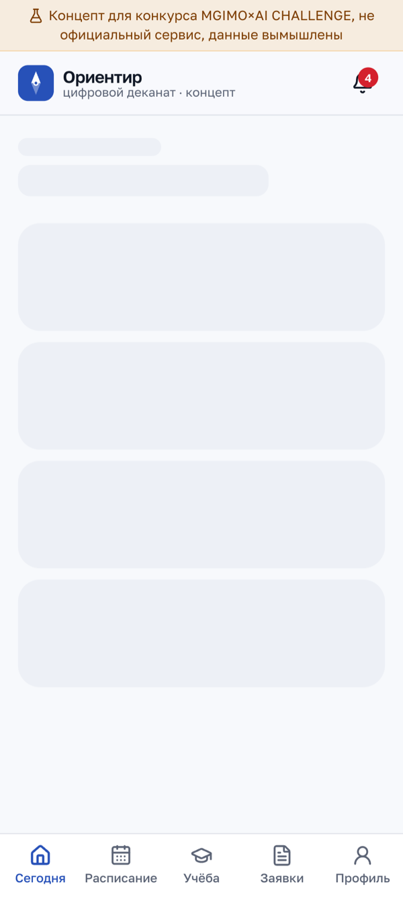<figcaption><b>Неудачно.</b> 17.11, первая съёмка всех экранов (коммит 9721dd1). Снимок сделан до конца загрузки: вместо данных скелетоны.</figcaption></figure>
<figure class="phone crop">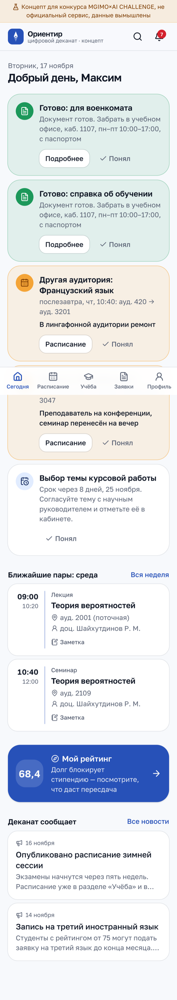<figcaption><b>Неудачно.</b> 17.11 (коммит bc8a16b). Съёмка после тестов, которые меняют данные: нет главной карточки «Пересдача 2», счётчик уведомлений 7.</figcaption></figure>
<figure class="phone crop">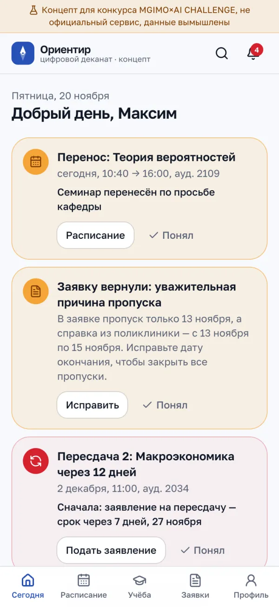<figcaption><b>Итог.</b> 20.11. Съёмка на свежей базе: перенос пары, возвращённая заявка, пересдача и срок заявления в одной карточке.</figcaption></figure>

После второго случая съёмку вынесли в отдельный прогон (`npm run screens`): база сбрасывается перед съёмкой, экраны только для чтения снимаются первыми, а экраны, которые меняют данные, — в конце и под копиями персонажей.

### 7.2. Готовый кабинет студента

<figure class="phone">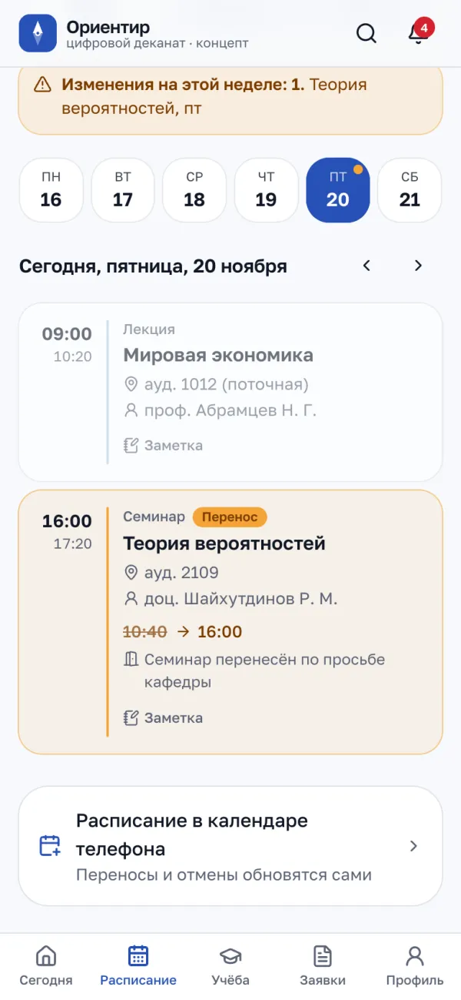<figcaption>Расписание: перенос выделен цветом, «10:40 → 16:00» и причина.</figcaption></figure>
<figure class="phone">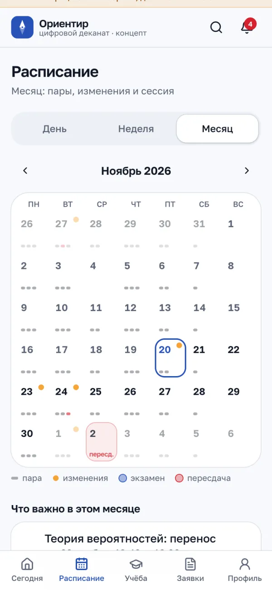<figcaption>Месяц: пары, изменения, экзамены и пересдача.</figcaption></figure>
<figure class="phone">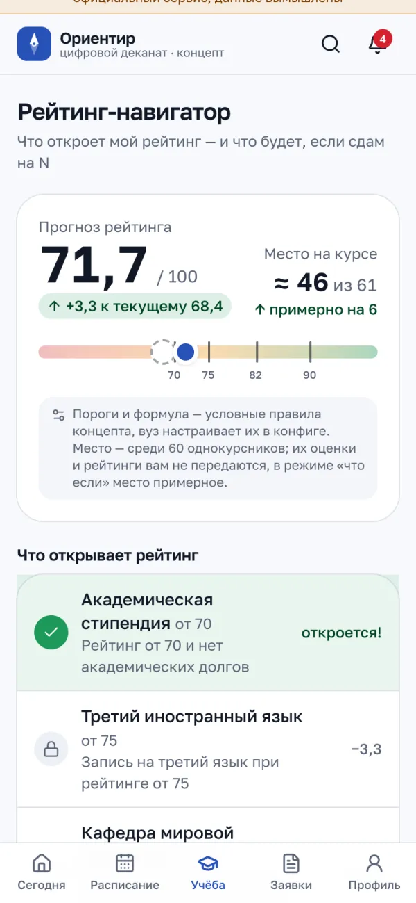<figcaption>Рейтинг «что если»: при пересдаче на 70 рейтинг 68,4 → 71,7, стипендия откроется.</figcaption></figure>

<figure class="phone">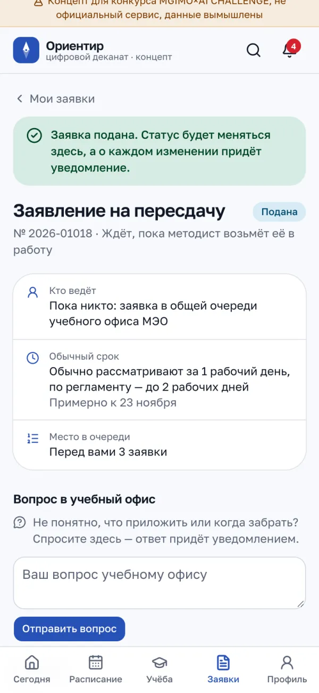<figcaption>Заявление из рейтинга: кто ведёт, обычный срок, место в очереди.</figcaption></figure>
<figure class="phone">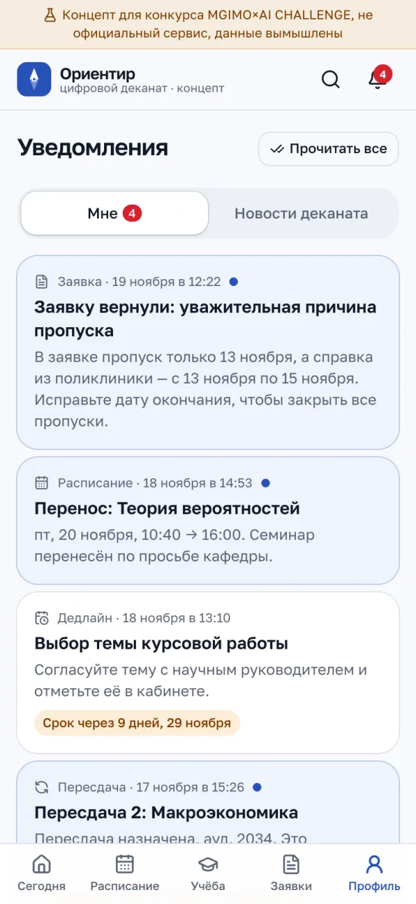<figcaption>Уведомления: свои изменения, дедлайны, статусы заявок; отдельно новости деканата.</figcaption></figure>
<figure class="phone">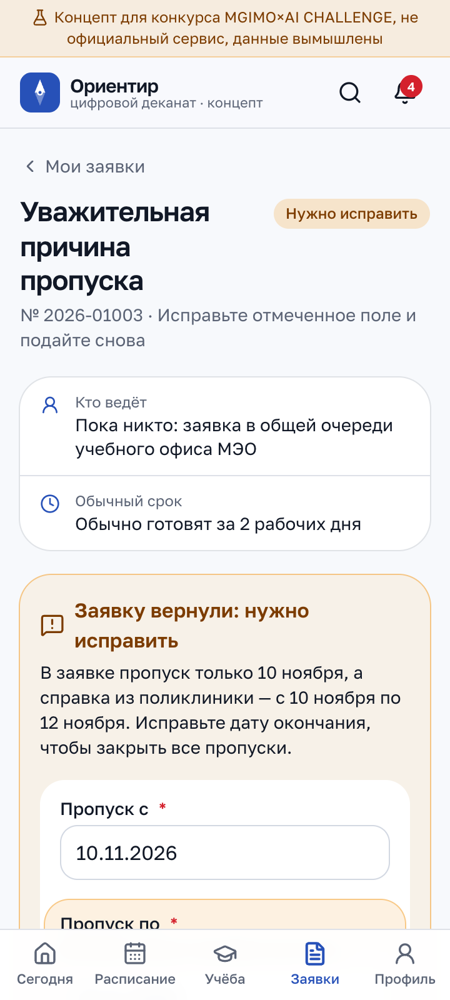<figcaption>Заявку вернули с причиной: студент правит отмеченное поле и подаёт снова.</figcaption></figure>

<figure class="phone">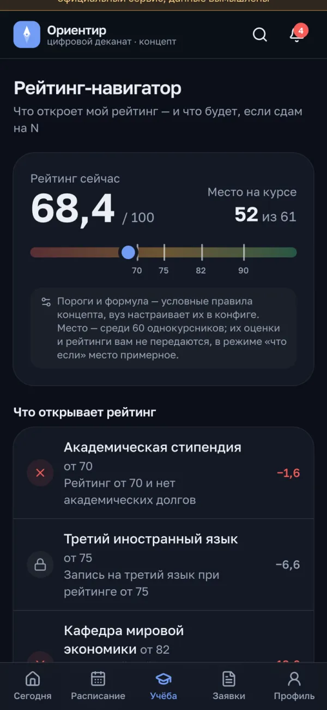<figcaption>Тёмная тема: светлая, тёмная или как в системе.</figcaption></figure>
<figure class="phone">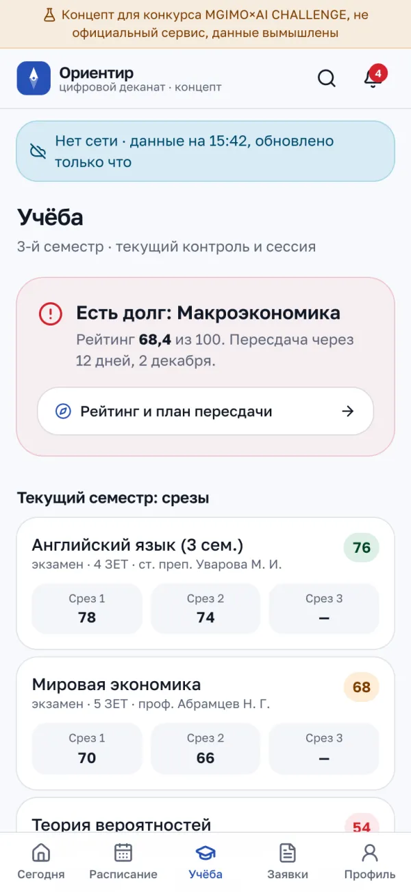<figcaption>Без сети: данные из кэша с пометкой времени.</figcaption></figure>
<figure class="phone">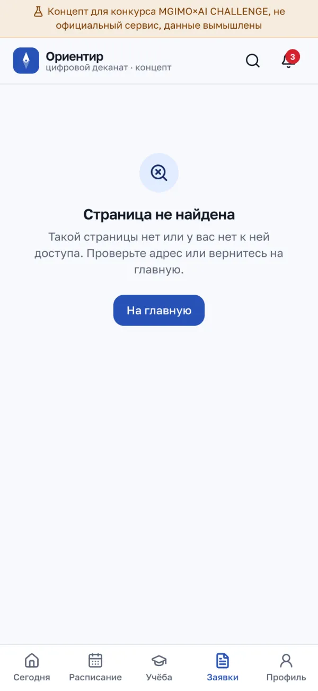<figcaption>Адрес чужой заявки: «Страница не найдена» (404).</figcaption></figure>

### 7.3. Кабинет методиста

<figure class="wide">
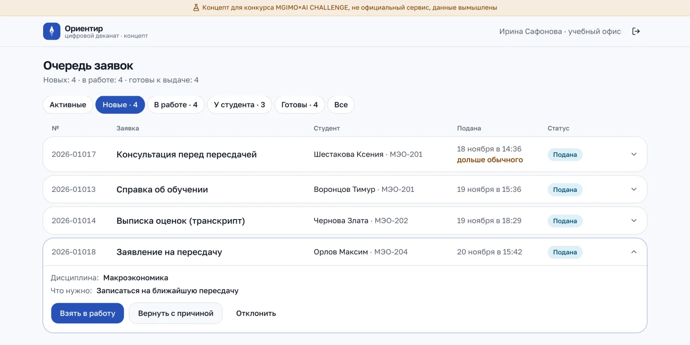
<figcaption>Очередь учебного офиса на компьютере: фильтры по статусам, заявка раскрывается на месте, кнопки «Взять в работу», «Вернуть с причиной», «Отклонить». По замечанию проверки очередь на компьютере стала таблицей; на телефоне остались карточки.</figcaption>
</figure>

## 8. Вход, хранение данных и защита

### 8.1. Вход

Студент входит по логину и паролю. Регистрации нет: в настоящем вузе аккаунты создаёт деканат, в демо — скрипт с вымышленными данными. Для жюри на странице входа есть кнопки «Войти как…».

Пароль в базе хранится не в открытом виде, а как хеш argon2id с параметрами по рекомендации OWASP. Даже при утечке базы пароль из него не восстановить.

После входа браузер получает случайный токен сессии в cookie, недоступной скриптам страницы (`httpOnly`). Сессия хранится в базе 7 дней. Роль (студент или методист) задаёт сервер, передать её из браузера нельзя.

### 8.2. Где хранятся данные

Данные лежат в PostgreSQL 17 на собственном сервере, в Docker. Наружу открыт только HTTPS через Caddy, база снаружи недоступна.

Все данные вымышлены. Их создаёт скрипт сида, а даты считаются от текущего дня, поэтому сюжет демо остаётся актуальным до 28 ноября. Медицинские документы к заявкам не загружаются: это персональные данные особой категории.

Офлайн-копия трёх разделов хранится в браузере отдельно для каждого пользователя и стирается при выходе.

### 8.3. Защита

| Угроза | Защита простыми словами |
| --- | --- |
| Открыть чужую заявку, подставив её номер в адрес | Сервер ищет заявку сразу с условием «и она принадлежит тому, кто вошёл». Чужая и несуществующая заявка неотличимы: обе дают «не найдено» (404) |
| Студент открывает кабинет методиста | Роль проверяется на сервере, студент получает 404 |
| Вызвать действие методиста в обход интерфейса | Каждое действие на сервере само проверяет сессию и роль; статусы меняются только по таблице разрешённых переходов |
| Подменить номер студента в форме | Номер студента берётся только из сессии, не из формы |
| Сменить пароль или логин общего демо-аккаунта | Наружу открыты только вход, выход и проверка сессии |
| Подбор паролей | Не больше 30 попыток входа в минуту с одного адреса |
| Два методиста одновременно меняют статус | Второй получает ответ «уже обработали» |
| Узнать оценки однокурсников | В браузер уходит только место на курсе и грубая гистограмма; при выборке меньше 10 человек место скрыто |
| Ссылка на календарь попала к другому | Ссылка открывается случайным токеном, в базе только его хеш; кнопка «перевыпустить» отключает старую |
| Ключи в коде или браузере | Секреты только в переменных окружения сервера; ключей ИИ в прототипе нет |
| Чужой сайт встраивает кабинет во фрейм | Заголовки безопасности CSP, HSTS, запрет встраивания |

Защита проверяется автоматически: 12 из 83 сценариев Playwright посвящены безопасности. Подробно — `docs/specs/access-control.md` и раздел «Безопасность простыми словами» в README.

Проверить руками: войти как `orlov`, открыть свою заявку и скопировать адрес; в другом окне инкогнито войти как `sokolova` и открыть этот адрес — будет «Страница не найдена».

## 9. Что сделано вручную

Работу вёл один человек. Код, спецификации и тесты писал ИИ-ассистент; человек ставил задачи и проверял результат.

| Что | Как это отражено в репозитории |
| --- | --- |
| Постановка задач ассистенту на каждом этапе | `docs/process/prompts.md` |
| Решение о составе прототипа и запрет его пересматривать | Постановка 1: «Что выбрано (не пересматривай)» |
| Приёмка результата: «готово» только при зелёном тесте или ручном проходе сценария | `CLAUDE.md`, «Как работаем» |
| Согласование того, что сознательно не делать: чат-бот, QR-справка, push-уведомления, часть находок проверки | `docs/plan.md` (Won't), `docs/decisions.md` («Не делали (как и договорились)») |
| Порядок урезания на случай нехватки времени и то, что не урезается никогда | `docs/plan.md` |
| Проверка кабинета со своего телефона: вход, «Сегодня», расписание, рейтинг, тёмная тема | замечания вернулись ассистенту, например обрезанные чипы дней в тёмной теме |
| Сервер и домен: поддомен `orientir.rapira-cloud.ru`, доступ к серверу для ассистента | `deploy/`, README; саму выкладку по ssh делал ассистент |
| Просмотр демо-видео и замечания к нему: курсор вместо кругов, плавность, текст титров | `pitch/demo/` |

## 10. Границы прототипа

- Всё работает на настоящей базе данных, заглушек в коде нет.
- Правила рейтинга условные: формула, пороги и число попыток лежат в конфиге и на экране помечены как условные. Вуз меняет их без правки кода.
- Место на курсе в режиме «что если» примерное: прогноз сравнивается с текущими рейтингами однокурсников.
- Расписания и ведомостей настоящего вуза в прототипе нет, к реальным системам он не подключается.
- Сознательно отложены: экзамены в подписке на календарь, офлайн для других месяцев расписания (`docs/decisions.md`).
- Чат-бота, QR-справки, перевода на другие языки и push-уведомлений нет сознательно.
