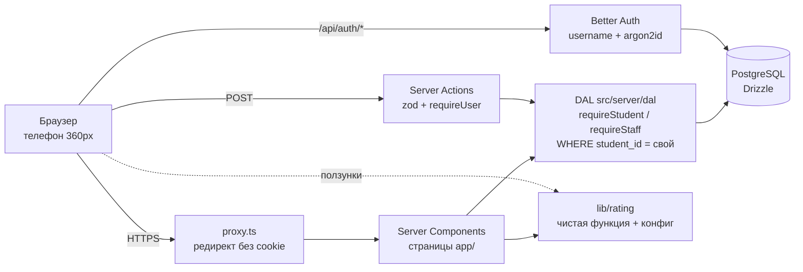

# План: «Ориентир» — цифровой деканат (концепт)

Дата: 17.11.2026. Сдача: 22.11.2026 23:59 МСК. Прототип работает до 28.11.
Основа: docs/00-brief.md (требования и критерии), docs/ideas/critique.md §5–7 (выбор), docs/research/04-tech.md (стек и безопасность).

## Демо-момент одной фразой
Студент с «хвостом» двигает ползунок «если пересдам на 70» и сразу видит, что рейтинг растёт с 68,4 до 71,7, долг закрывается, стипендия открывается, а место на курсе поднимается. Одной кнопкой он записывается на консультацию, а методист в соседнем окне переводит заявку в «Готова».

## Must / Should / Won't

| Приоритет | Что | Готово, когда |
|---|---|---|
| Must | Вход по логину и паролю (argon2id), профиль: ФИО, факультет, направление, курс, группа | 3 тестовых аккаунта входят, хеш в БД `$argon2id$` |
| Must | Расписание: сегодня и неделя, аудитория, преподаватель, перенос/замена аудитории/отмена выделены | у студента Б виден перенос пары на этой неделе |
| Must | Успеваемость: срезы, итоговые баллы, зачёты, сессия, «как у меня дела» (сводка) | у А «всё закрыто», у Б виден долг |
| Must | Заявки: 6 типов, подача онлайн, таймлайн статусов, «возвращена с причиной» → правка → повторная подача | сквозной путь проходит в Playwright |
| Must | Очередь методиста одной страницей (роль staff): смена статуса, «вернуть с причиной» | студент получает уведомление о смене статуса |
| Must | Уведомления: новости деканата, напоминания о дедлайнах и изменениях | лента с непрочитанными, счётчик в шапке |
| Must | Безопасность: IDOR → 404, роль staff, Playwright-тесты | `npm run test:e2e` зелёный |
| Must | Рейтинг-навигатор «что если»: индикатор, пороги (условные, из конфига), ползунки, место на курсе агрегатом | спека + юнит-тесты формулы |
| Must | Режим пересдачи: лестница попыток (2 пересдачи + комиссия), «записаться на консультацию / подать заявление» создаёт заявку | у Б заявка появляется в очереди методиста |
| Should | Главная «Сегодня»: 3–5 карточек по правилам, схлопывание дублей, «понял» | карточки у А и Б разные |
| Should | Полировка 360 px, пустые состояния, skeleton, error/not-found | ручной проход на 360 px + скриншоты Playwright |
| Should | Dockerfile + amvera.yml, миграции при старте | `docker build` проходит локально |
| Won't | Чат-бот / GigaChat, QR-справка, i18n, сторис, push-уведомления | — |

## Критерий → фича

| Критерий (§7) | Чем закрываем |
|---|---|
| 1. Проработанность идеи | Ядро полностью; рейтинг-навигатор с порогами и режимом пересдачи, замкнутый на заявку в деканат; «Сегодня» — деканат пишет первым |
| 2. Нейротехнологии | CLAUDE.md, AGENTS.md, .claude/rules, спеки docs/specs/*, docs/process/prompts.md, журнал ошибок ИИ в docs/decisions.md, тесты как проверка ИИ-кода |
| 3. Имплементация | Данные в Postgres, DAL с фильтром по владельцу, роль staff, argon2id, секреты в env, Playwright IDOR-тесты, сид относительно now(), сброс демо |
| 4. Качество | Единый стиль на shadcn/ui, нижний таббар, 360 px, skeleton/пустые состояния/ошибки, быстрые серверные страницы |

## Архитектура

Правило: страница и action никогда не ходят в БД напрямую, только через DAL. DAL берёт id студента из сессии, а не из формы или URL.

## Таймлайн

| День | Что |
|---|---|
| 17.11 (пн) | План, каркас, вход, сид, сквозной путь брифа, очередь методиста, IDOR-тесты |
| 18.11 (вт) | Рейтинг-навигатор, режим пересдачи, спека и юнит-тесты; «Сегодня» |
| 19.11 (ср) | Полировка 360 px, пустые состояния, Dockerfile; регистрация на Amvera (человек), первый деплой |
| 20.11 (чт) | Проверка с телефона и из 2–3 сетей, мини-опрос 2–3 студентов о рейтинге, правка порогов |
| 21.11 (пт) | Описание процесса со скриншотами, видео до 5 мин |
| 22.11 (сб) | Буфер, FEATURE FREEZE в 12:00, сдача |

## Порядок урезания (если не успеваем)
1. «Сегодня» → простая лента уведомлений на главной.
2. Место на курсе → только пороги без места.
3. Лестница пересдачи → одна строка «осталось попыток: N» + кнопка заявки.
4. Ползунки по каждой дисциплине → один общий ползунок «средний балл сессии».
Не урезаем никогда: сквозной путь брифа, IDOR-защиту и тесты, 360 px, плашку «концепт».

## Статус на 17.11, вечер
| Блок | Состояние | Чем проверено |
|---|---|---|
| Вход, профиль, расписание, успеваемость, заявки, уведомления | готово | e2e `02-happy-path`, `05-mobile` |
| Очередь методиста | готово | e2e `02-happy-path` |
| IDOR и роли | готово | e2e `01-security` (9 сценариев) |
| Рейтинг-навигатор и режим пересдачи | готово | юнит `calc.test.ts`, e2e `03-rating` |
| «Сегодня» | готово | юнит `rules.test.ts`, e2e `04-today` |
| 360 px, пустые состояния, скелетоны, ошибки | готово | e2e `05-mobile` на всех экранах |
| Dockerfile + amvera.yml | готово, образ собирается локально | `docker build` |
| Второй заход: алерты Dependabot (minimatch, esbuild) | закрыты overrides, `npm audit` 0 | сборка + все тесты |
| PWA и офлайн для «Сегодня», расписания, учёбы | готово | e2e `06-pwa` (проверен на поломку) |
| Подписка на расписание .ics | готово | юнит `ics.test.ts`, e2e `07-calendar` |
| Прозрачность заявки | готово | юнит `dates.test.ts`, e2e `08-transparency` |
| Поиск Ctrl+K | готово | юнит `match.test.ts`, e2e `09-search` |
| Заметка к паре | готово | e2e `10-notes` (проверен на поломку) |
| Тёмная тема | готово | e2e `11-theme` |
| Третий заход: правки по независимой проверке (жюри + аудит) | 10 пунктов из 10 + находки агента-ревьюера | см. docs/decisions.md, «Независимая проверка» |
| Копии персонажей и кнопки «Войти как…» | готово | e2e `12-personas` |
| «Вопрос в учебный офис» | готово | e2e `14-messages` (проверен на поломку) |
| Docker-образ после правок | собран, старт на пустой базе и «база позже приложения» проверены вручную | — |
| Деплой на Amvera | ждёт аккаунта | — |
| Опрос 2–3 студентов о правилах рейтинга, видео, описание процесса со скриншотами | не начато | — |
