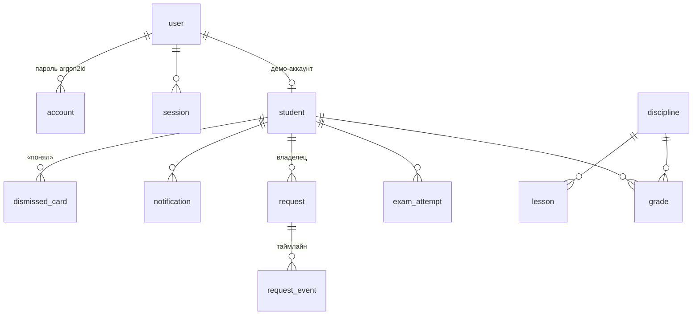
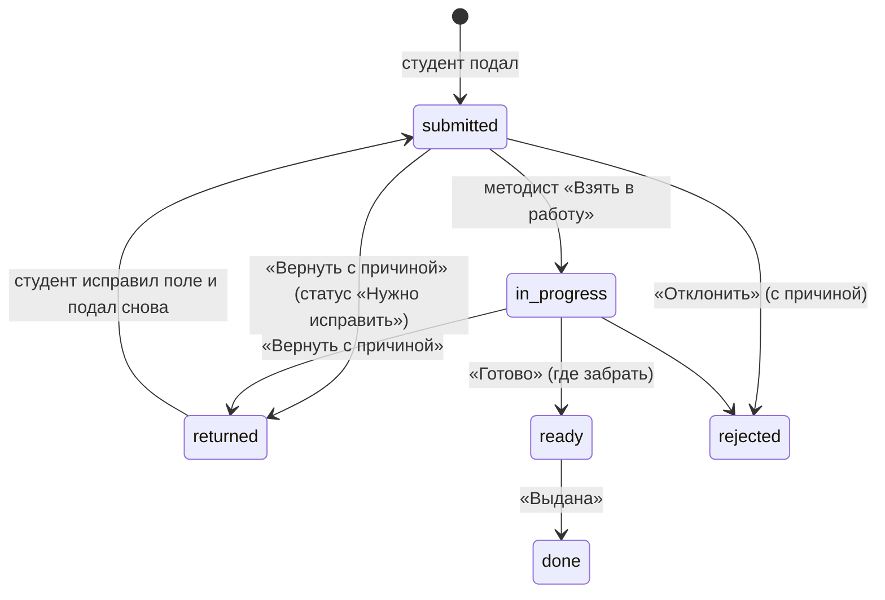

# Спека: модель данных

Источник истины: `src/server/db/schema.ts` (Drizzle), миграции в `drizzle/`. PostgreSQL 17.

## Таблицы

| Таблица | Назначение | Чей доступ |
|---|---|---|
| `user`, `session`, `account`, `verification` | Better Auth. `user.role`: `student` / `staff`, `username` — логин | только Better Auth |
| `student` | Профиль: ФИО, факультет, направление, курс, группа, поток (`cohort`), зачётка. `user_id` есть только у демо-аккаунтов; ~60 однокурсников без входа нужны для агрегата «место на курсе» | свой — по `user_id` из сессии |
| `discipline` | Дисциплина семестра: ЗЕТ, форма контроля, преподаватель | справочник |
| `grade` | Результат студента: 3 среза, итоговый балл, статус `open`/`passed`/`debt`, `passed_on_retake` | свои — по `student_id` |
| `exam_attempt` | Попытки сдачи: `main`/`retake1`/`retake2`/`commission`, дата, аудитория, балл, результат. Отсюда лестница пересдач и расписание сессии | свои |
| `lesson` | Пара группы: время, аудитория, преподаватель, тип; изменения: `status` (`moved`/`room_changed`/`cancelled`), `original_starts_at`, `original_room`, `change_note`, `changed_at` | пары своей группы |
| `request` | Заявка: человекочитаемый `number`, `type` (ключ каталога), `status`, `payload` (jsonb, поля по каталогу), `return_reason` + `return_field` (что исправить), `staff_comment`, `assignee_name` (кто ведёт) | свои; методист — все |
| `request_event` | История статусов (таймлайн): статус, комментарий, кто (`student`/`staff`), время | через свою заявку |
| `news` | Новости деканата: общие (`faculty = null`) или факультета, `important` | все студенты (своего факультета) |
| `notification` | Персональные уведомления: `schedule`/`deadline`/`request`/`retake`/`grade`, `due_at`, `read_at` | свои |
| `lesson_note` | Своя заметка к паре (до 500 символов) | своя — по `student_id` |
| `calendar_token` | SHA-256 личного токена подписки на календарь | только владелец выпускает, читает маршрут `.ics` по хешу |
| `dismissed_card` | Скрытые карточки «Сегодня» (ключ карточки) | свои |

## Статусы заявки

Прозрачность: `assignee_name` ставится, когда методист первым меняет статус. Обычный срок — `typicalDays` в каталоге (условно), ориентир считается в рабочих днях по Москве (`addBusinessDays`, праздники не учитываются). Место в очереди — число заявок «Подана», поданных раньше, плюс один: студент видит только два числа, без чужих данных.

Переходы методиста — `STAFF_TRANSITIONS` в `src/lib/requests/catalog.ts`, проверяются на сервере. Каждая смена статуса пишет `request_event` и персональное уведомление студенту.

## Каталог заявок (`src/lib/requests/catalog.ts`)
Справка об обучении · Справка для военкомата · Уважительная причина пропуска · Выписка оценок (RU/EN) · Заявление на пересдачу · Консультация перед пересдачей. Поля описаны декларативно (`text`/`textarea`/`date`/`number`/`select`), форма и серверная проверка (`validate.ts`) строятся из одного описания; неизвестные поля отбрасываются.

## Сид и даты
`scripts/seed.ts`. Все даты — от момента запуска (`now`): расписание на −2…+7 недель, перенос — ближайший будущий семинар группы Орлова, пересдача — через 12 дней, дедлайны — через 7 и 9 дней, сессия — через 5 недель, по одному переносу в каждую следующую неделю, чтобы демо не устаревало. Проверка: `SEED_DAYS_AGO=11 npm run db:reset` засевает базу «как будто 11 дней назад» (тест `e2e/99-seed-dates.spec.ts`). Однокурсники генерируются детерминированным ГПСЧ (одинаковые при каждом сбросе). Сброс: `npm run db:reset` (удалить схему → миграции → сид, ~0,3 с).

| Аккаунт | Кто | Данные |
|---|---|---|
| `sokolova`, `sokolova2`, `sokolova3` | Анна Соколова, МЭО-201 | рейтинг 87,5, без долгов, справка готова, смена аудитории |
| `orlov`, `orlov2`, `orlov3` | Максим Орлов, МЭО-204 | рейтинг 68,4, долг по макроэкономике (2 попытки из 4 сгорели), перенос семинара, заявку вернули с причиной |
| `metodist`, `metodist2`, `metodist3` | Ирина Сафонова, Павел Лещинский, Наталья Гребнева — учебный офис | общая очередь заявок |

Копии (2, 3) — отдельные студенты с тем же сюжетом: эксперты жюри работают параллельно и не «затаптывают» сюжет друг другу. В агрегат «место на курсе» демо-персонажи не входят: каждый видит своё место среди 60 вымышленных однокурсников.